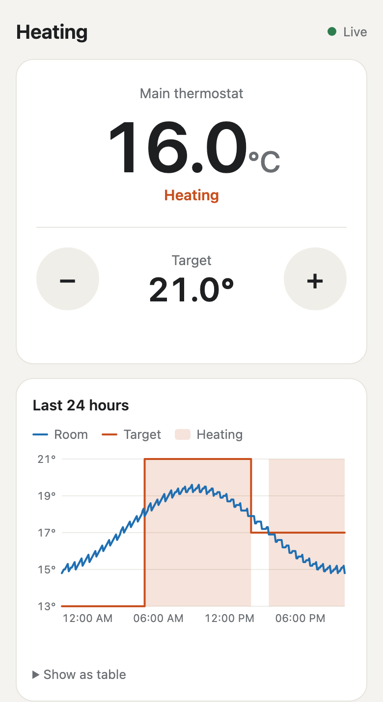

# Uponor Bridge

Control an Uponor Smatrix Base underfloor heating system from your phone's browser, using a small ESP32 stick on the thermostat bus.

The stick serves its own web page, so all you need is the stick, your Wi-Fi and a phone. It works out which thermostats you have by listening to the bus, so there are no addresses to look up or configure. Home Assistant is optional.



*The web page, shown here with simulated data.*

## Features

- **Web page:** room temperature, target control, other rooms, and a 24-hour graph, with light and dark themes
- **Automatic detection:** finds up to 8 thermostats and picks the one it can control
- **Confirmed changes:** a new target only shows as set once the thermostat confirms it on the bus
- **Wi-Fi setup hotspot:** if the stick can't join a network, it starts its own hotspot so you can enter your details
- **Quiet by default:** it only transmits when you change the temperature, in the gaps between polls
- **Wiring check:** shows a clear message when no data is arriving from the bus
- **Optional Home Assistant support:** appears as a normal ESPHome device if you want it

## What you need

- An Uponor Smatrix Base system with a wired RS485 thermostat bus. The wireless Smatrix Wave system won't work.
- An ESP32 board. This was developed on an ESP32-PICO-V3-02 stick (M5StickC Plus2 class) with 8 MB of flash.
- An RS485-to-TTL converter.
- A 5V power supply for the stick.

## Wiring

| Stick | Converter |
|---|---|
| GPIO0 (TX) | TTL input |
| GPIO26 (RX) | TTL output |
| GND | GND |

Connect the converter's A/B side to the A/B terminals on the controller or on a thermostat. See [ESPHome's Uponor Smatrix docs](https://esphome.io/components/uponor_smatrix/) for more on connecting to the bus.

If the page says there's no bus data, check this wiring first, and try swapping A and B.

**Don't connect two power sources.** If the stick is powered from your installation, disconnect that supply before plugging in USB.

## Install

You need [ESPHome](https://esphome.io/guides/installing_esphome/). This project was built and tested with version 2026.2.1.

```bash
pip install esphome==2026.2.1
cp secrets.example.yaml secrets.yaml   # then fill in your own values
esphome run uponor-bridge.yaml
```

Create your own passwords in `secrets.yaml`. The firmware also needs an `api_key`, even if you never use Home Assistant. It must be a base64-encoded 32-byte key, which you can make with `openssl rand -base64 32`.

For a different board or pins, change `esp32:` and `uart:` in `uponor-bridge.yaml`.

## First start

1. Connect the stick to the bus and power it on.
2. If it can't join a Wi-Fi network, it starts a hotspot called `Uponor Bridge Setup`. Connect to it with the `ap_password` from `secrets.yaml`, then enter your Wi-Fi details on the page that opens. If no page opens, go to `http://192.168.4.1`.
3. Open `http://uponor-bridge.local` or the stick's IP address. The username is `admin` and the password is your `web_password`.
4. Wait about 2 minutes while it detects your thermostats. The status then shows **Ready**.

The result is saved, so it survives a restart. Use **Re-run detection** under *Device details* if your thermostats change.

## Optional: Home Assistant

You don't need Home Assistant, and the stick runs fine without it. Add it if you want things the web page can't do:

- Control from outside your home network
- History longer than 24 hours that survives a restart
- Automations and schedules

Add the stick through the ESPHome integration with your `api_key`. You'll get a climate entity, room sensors and the status sensors. The web page keeps working alongside it.

## How detection works

During the 2-minute window, the stick counts how often each thermostat includes its setpoint when it replies to a poll:

- **In less than half of its replies:** it only reports its setpoint when that changes, so it can be controlled. This is the main thermostat.
- **In half or more of its replies:** it repeats its setpoint on every poll, so it's likely to overwrite anything we send. These are shown read-only.

If exactly one thermostat qualifies, it becomes the main thermostat. If none or several do, the stick stays read-only and never transmits on a guess.

## Protocol notes

These notes come from captures of one system, plus ESPHome's `uponor_smatrix` component.

- 19200 baud, 8N1. The controller polls each thermostat in turn, about every 10 seconds on the system tested.
- There are no length or delimiter bytes, so packets are found by checking the CRC at each valid length.
- Packets have no sender field. The poll, the reply and the update all carry the thermostat's address.
- Temperatures are in tenths of a degree Fahrenheit, so `0x02CC` = 716 = 71.6 °F = 22.0 °C.

```
AA BB CC DD | 3B 00 00 | 3B 02 CC | CRC CRC
address     | setpoint | setpoint | CRC16 (poly 0xA001, init 0xFFFF, little-endian)
            | (empty)  | (22.0)   |
```

A polling round for one thermostat looks like this:

1. Poll: `address FF crc`
2. Thermostat reply, including room temperature (`0x40`)
3. Controller update, including setpoint (`0x3B`), demand (`0x3D`) and limits (`0x37`, `0x38`)

In the demand value, `0x0040` means heat is being requested and `0x1000` means cooling mode.

## Status

Tested on one Uponor Smatrix Base system with five thermostats.

| Tested and working | Not tested yet |
|---|---|
| Automatic detection of the main thermostat | Any other Uponor installation |
| Saved detection after a restart | Wi-Fi setup through the hotspot |
| Setting the temperature from the web page | Connecting through Home Assistant itself |
| Thermostat confirming changes on the bus | The read-only fallback |
| Password protection on the web page | Re-run detection |

The graph history is kept in memory, so a restart or power cut clears it. It covers the main thermostat for the last 24 hours.

## Project layout

| Path | Purpose |
|---|---|
| `uponor-bridge.yaml` | Main firmware configuration |
| `uponor-bridge-debug.yaml` | The same, plus a hex log of all bus traffic |
| `components/uponor_auto/` | Custom ESPHome component |
| `web/ui.js` | The web page |
| `secrets.example.yaml` | Template for `secrets.yaml` |

## Security

The web page uses plain HTTP with a password, so keep it on your home network and don't expose it to the internet. Never commit `secrets.yaml` or a flash dump, because both contain your credentials. `.gitignore` already excludes them.

## Disclaimer

This is an unofficial hobby project, not affiliated with or endorsed by Uponor. It transmits on your heating system's bus, so use it at your own risk.

## Credits

Built on [ESPHome](https://esphome.io/). The protocol knowledge and parts of the climate logic come from its `uponor_smatrix` component by kroimon.
